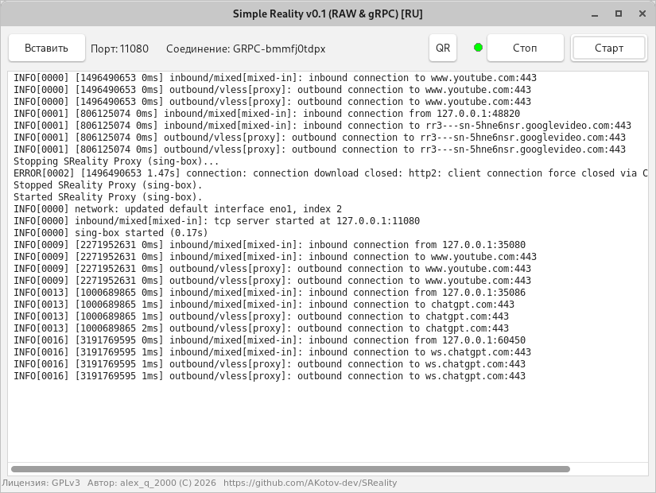

## SReality - Простейший графический прокси-клиент

Собран с учетом поддержки устаревших ОС. Тестирование проходило на VM Mageia-6 2017 года выпуска.  
Под капотом `SReality` - [sing-box-linux-amd64-musl](https://github.com/SagerNet/sing-box/releases).

Зависимости (не включены в пакет): gtk2, lib64proxy-gnome, lib64proxy-kde

- Рабочий каталог, конфигурации: ~/.config/sreality
- Сервис запуска системного прокси: /etc/systemd/user/sreality.service

**Панель:** 3x-ui-[v3.2.0](https://github.com/MHSanaei/3x-ui/releases/tag/v3.2.0), xray-26.5.9, Мин. версия клиента-25.9.11. Макс. версия клиента-25.9.11.  
  
**Установка панели:**
```
bash <(curl -Ls https://raw.githubusercontent.com/mhsanaei/3x-ui/master/install.sh) v3.2.0
```

> [!IMPORTANT]
> Для повышения безопасности настоятельно рекомендуется [ограничить внешний доступ к панели 3x-ui и настроить управление через SSH-туннель](https://github.com/AKotov-dev/SReality/blob/main/doc/hide_3x-ui.md).



### Использование
Cоздать конфигурацию в панели [3X-UI](https://github.com/MHSanaei/3x-ui/releases), скопировать в буфер, вставить в `SReality`, нажать "Старт".

<details>
<summary>Связка VLESS Reality (3X-UI)</summary>
  
- Транспорт: RAW или gRPC
- Протокол: Шифрование/Расшифрование - X25519 / ML-KEM-768 не используется
- Безопасность: Reality - mldsa65 Seed и mldsa65 Verify не используются
- Сниффинг не используется
- Клиенты: Настройка клиента (для RAW): Учетные данные - Flow: xtls-rprx-vision

При настройке gRPC не забываем указывать `Имя сервиса`, например - `grpc-service`, `Authority` не используется.
</details>

Байпас доменных зон `.ru` и `.рф` - **встроенный**. Глобальный прокси включается нажатием кнопки "Старт" (сервис enable, автозагрузка). При нажатии "Стоп" прокси отключается и снимается из автозагрузки (disable). Кнопка "QR" показывает код конфигурации для смартфона.

На смартфонах удобно использовать [NekoBox](https://github.com/MatsuriDayo/NekoBoxForAndroid/releases). В настройках не забываем менять Remote DNS и Direct DNS [на обычные](https://github.com/MatsuriDayo/NekoBoxForAndroid/issues/1176), например `1.1.1.1` или `8.8.8.8`.

Похожие инструменты: [SS-Cloak](https://github.com/AKotov-dev/SS-Cloak), [HyBridge](https://github.com/AKotov-dev/HyBridge), [NaiveGUI](https://github.com/AKotov-dev/NaiveGUI).
