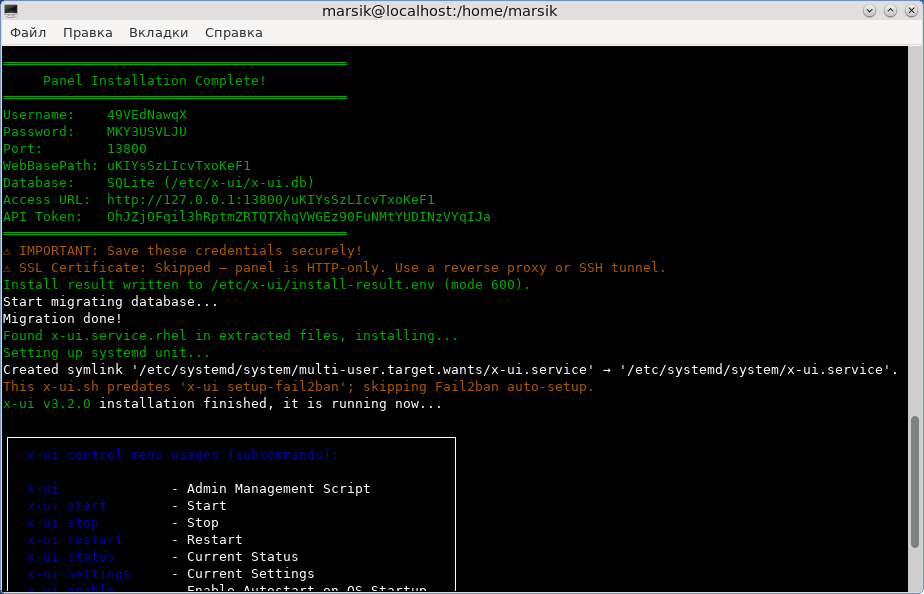
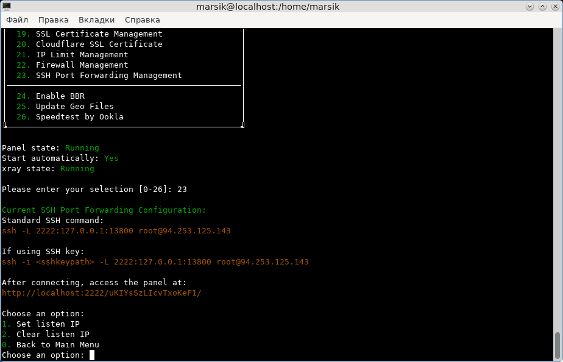

Чтобы не афишировать панель 3x-ui наружу, иногда требуется спрятать её внутри VPS за адресом 127.0.0.1.  
Доступ к панели будем получать через SHH-туннель, пробрасывая порт панели на локальный адрес клиента и его порт.
  
Во время установки панели сразу выбираем пункт 4:
  

По завершению установки можно сразу скопировать локальный адрес, по которому доступна панель внутри сервера:  
  

Далее входим в режим управления панелью командой `x-ui` и меняем имя Пользователя и Пароль (6).  
  
Затем получаем данные для настройки форвардинга по ssh (23)  

 

На клиенте прокидываем порт панели с сервера на свой, например 2222:
```
ssh -N -L 2222:127.0.0.1:13800 root@IP_СЕРВЕРА
```
И заходим на клиенте через браузер по ранее выданному в (23) адресу
```
http://localhost:2222/opyaGJ4IFD3cPVC3Ta/
```
Чтобы панель в создаваемых ей конфигурациях корректно прописывала IP сервера или Домен (а не localhost), заходим в **НАСТРОЙКИ - ПАНЕЛЬ - ПОДПИСКИ**, указываем IP сервера или Домен в поле `Домен прослушивания` и Сохраняем:  


Теперь управлять панелью можно через туннель SSH.
