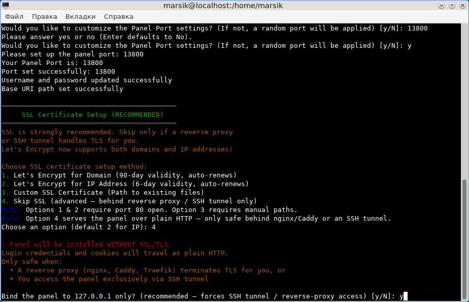
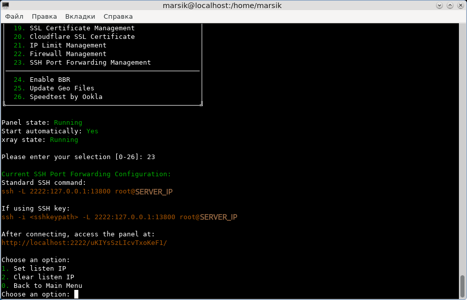
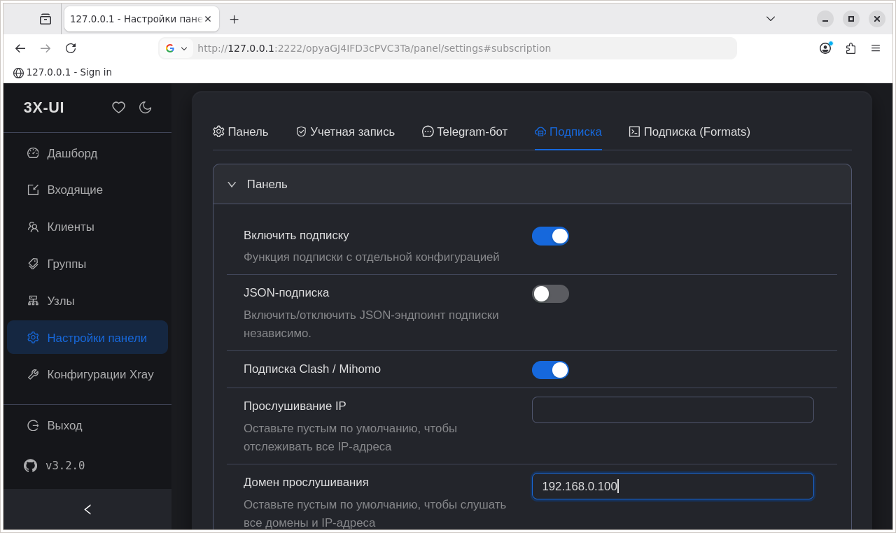

## Доступ к панели 3x-ui через SSH-туннель

Для повышения безопасности панели управления **3x-ui** рекомендуется ограничить её доступность извне, привязав веб-интерфейс к локальному адресу `127.0.0.1`.

В этом случае панель будет доступна только изнутри VPS. Для удалённого управления будем использовать SSH-туннель, который позволит перенаправить порт панели на локальный адрес клиентского компьютера.

### 1. Установка панели

Во время установки 3x-ui выбираем пункт **(4)**, чтобы настроить локальный адрес прослушивания панели:



После завершения установки можно скопировать локальный URL, по которому панель будет доступна непосредственно на сервере:


### 2. Настройка учётных данных

Переходим в меню управления панелью, выполнив команду:

```bash
x-ui
```

Меняем имя пользователя и пароль (пункт **6**).

### 3. Получение параметров SSH-туннеля

В меню управления панелью выбираем пункт **(23)**, чтобы получить данные для настройки SSH-перенаправления:



### 4. Создание SSH-туннеля

На клиентском компьютере выполняем команду (от пользователя):

```bash
ssh -N -L 2222:127.0.0.1:13800 root@IP_СЕРВЕРА
```

Здесь:
- `2222` — локальный порт на клиентском компьютере, через который будет доступна панель;
- `127.0.0.1:13800` — адрес и порт панели внутри VPS;
- `root@IP_СЕРВЕРА` — учётная запись и IP-адрес сервера.

После установления SSH-соединения открываем браузер на клиентском компьютере и переходим по адресу, полученному ранее в пункте **(23)**. Например:

```text
http://localhost:2222/opyaGJ4IFD3cPVC3Ta/
```

Теперь веб-интерфейс 3x-ui доступен через SSH-туннель, при этом сам порт панели не требуется публиковать во внешнюю сеть.

### 5. Настройка адреса сервера в генерируемых конфигурациях

Поскольку панель прослушивает только локальный адрес `127.0.0.1`, при генерации клиентских конфигураций вместо публичного IP-адреса или доменного имени сервера может указываться `localhost`.

Чтобы исправить это, открываем:

**НАСТРОЙКИ → ПАНЕЛЬ → ПОДПИСКИ**

В поле `Домен прослушивания` указываем публичный IP-адрес или доменное имя VPS, которое будет использоваться клиентами для подключения.

Сохраняем настройки:



### Готово!

Теперь панель 3x-ui доступна для удалённого управления исключительно через SSH-туннель, а создаваемые ею клиентские конфигурации содержат корректный публичный адрес сервера.

Таким образом, веб-интерфейс панели не требуется открывать для внешнего доступа.
